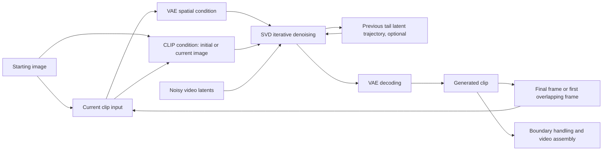

# SVD Extend

**Image-conditioned video continuation with Stable Video Diffusion.**

Given one starting image, SVD Extend generates successive video clips and assembles them into a longer sequence, with configurable concatenation, image conditioning, and latent overlap.

## Overview

The project builds on pretrained SVD-XT 1.1 and implements clip concatenation, initial-image semantic conditioning, and latent overlap. VAE latents provide spatial conditioning, while CLIP image embeddings provide semantic conditioning for a spatiotemporal U-Net.

The inference workflow supports configurable clip counts, frame assembly, lossless segment checkpoints, and interrupted-run recovery. It uses existing SVD weights without additional training.

## Implementation



- **Clip continuation:** each new clip uses the preceding clip's final frame as its image condition. In overlap mode, it uses the first frame of the preceding clip's final `k` frames instead.
- **Eight-channel input:** four noisy-latent channels are concatenated with four VAE image-conditioning channels. The pipeline uses the standard SVD U-Net.
- **Initial CLIP conditioning:** optionally retain the original image's CLIP embedding across clips while updating the VAE condition with each clip's input image.
- **Latent overlap:** retain the previous clip's final `k` latent frames at the initial noise level and after each denoising step. Inject these states into the next clip's prefix at matching sigma values, then omit its first `k` decoded frames during assembly. Trajectories are stored on CPU.
- **Segment recovery:** save lossless frames and conditioning states after each completed clip. Resume from the first unfinished clip using its assigned seed.

The two independent options expose four combinations:

| `--mode` | `--conditioning` | Behavior |
| --- | --- | --- |
| `concatenate` | `previous` | Continue from the previous final frame; re-encode its CLIP condition |
| `concatenate` | `initial` | Continue from the previous final frame; retain the initial CLIP condition |
| `overlap` | `previous` | Continue from frame `-k`; re-encode its CLIP condition and apply latent overlap |
| `overlap` | `initial` | Continue from frame `-k`; retain the initial CLIP condition and apply latent overlap |

## Usage

Create a Conda environment from the project root:

```shell
conda env create -f environment.yml
conda run -n svd_extend python -m pip install torch==2.7.1 torchvision==0.22.1 --index-url https://download.pytorch.org/whl/cu128
conda run -n svd_extend python -m pip install -r requirements-inference.txt
```

The CUDA build requires a compatible NVIDIA driver. These dependencies cover the current inference entries.

Copy [configs/resources.example.json](configs/resources.example.json) to `configs/resources.local.json` and set `base_model_path` to a local [SVD-XT 1.1](https://huggingface.co/stabilityai/stable-video-diffusion-img2vid-xt-1-1) Diffusers model root containing its model components and weights. Weights are not included. The standard eight-channel checkpoint is sufficient; no additional training is required.

Generate two clips with concatenation:

```shell
conda run --no-capture-output -n svd_extend python infer_svd_extend.py --input data/demo.jpg --mode concatenate --segments 2
```

Use overlap with the initial CLIP condition:

```shell
conda run --no-capture-output -n svd_extend python infer_svd_extend.py --input data/demo.jpg --mode overlap --conditioning initial --segments 2 --overlap-frames 5
```

The continuation entry defaults to **1024×576**, 25 frames per clip, and 25 denoising steps. It saves an MP4, a preview, a run manifest, and resumable segment checkpoints under `outputs/`. Conditioning FPS and export FPS are configured separately. The single-clip `infer_svd.py` entry retains its **512×320** default.

```shell
conda run -n svd_extend python infer_svd_extend.py --help
```

## Code Structure

| Path | Description |
| --- | --- |
| `infer_svd_extend.py` | Unified continuation entry, mode selection, segment loop, and resume |
| `infer_svd.py` | Single-clip inference entry and shared inference arguments |
| `pipelines/pipeline_stable_video_diffusion.py` | SVD denoising, CLIP conditioning, and optional latent overlap |
| `tools/svd_runtime.py` | Local resources, environment inspection, and run records |
| `tools/svd_continuation.py` | Frame planning, lossless checkpoints, and video assembly |
| `tools/svd_overlap.py` | CPU latent trajectories and compatibility checks |
| `configs/` | Resource configuration template |
| `data/demo.jpg` | Example input image |
