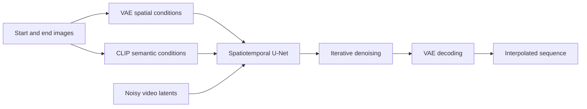
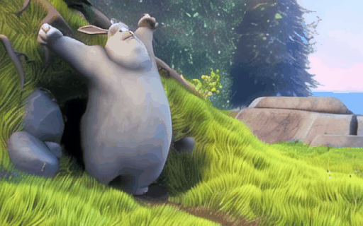

# SVD Interp

**Endpoint-conditioned video frame interpolation with Stable Video Diffusion.**

Given a start image and an end image, the model generates a video sequence connecting them.

## Overview

The project builds on Stable Video Diffusion and uses both endpoint images as conditioning signals. VAE latents provide spatial information, while CLIP image embeddings provide semantic information. A spatiotemporal U-Net generates the intermediate sequence through iterative denoising.

The repository includes model modules, selective fine-tuning code, and an image-pair inference entry point.

## Method



- **Endpoint conditioning:** VAE latents occupy the first and last temporal positions; a learned mask token fills the intermediate positions.
- **Nine-channel input:** four noisy-latent channels, four spatial-conditioning channels, and one binary channel marking endpoint versus intermediate positions.
- **Semantic guidance:** CLIP embeddings from both endpoints are concatenated as cross-attention context.
- **Video generation:** the spatiotemporal U-Net combines spatial and temporal information, with classifier-free guidance and an Euler scheduler during inference.
- **Selective fine-tuning:** the training implementation selects temporal transformer modules, the input convolution, and the mask token for optimization while freezing the remaining backbone parameters. The VAE and image encoder remain frozen.

## Example



[Video](assets/demo/interpolation.mp4) · [Frame sequence overview](assets/demo/contact_sheet.jpg)

The example contains 14 generated frames, including the two endpoint positions.

*Source images: Big Buck Bunny, (c) copyright 2008, Blender Foundation / www.bigbuckbunny.org, CC BY 3.0. The inputs were extracted, cropped, and resized; the displayed sequence is model-generated.*

## Usage

### Linux setup

From the `svd_interp/` directory, create a Conda environment and install [requirements.txt](requirements.txt). The dependency versions are a reference configuration, not a validated environment lock.

```bash
conda create -n svd_interp python=3.10 -y
conda activate svd_interp
python -m pip install -r requirements.txt --extra-index-url https://download.pytorch.org/whl/cu116
cp configs/resources.example.json configs/resources.local.json
```

### Inference

Edit `configs/resources.local.json` and set the paths to:

- [SVD-XT 1.1](https://huggingface.co/stabilityai/stable-video-diffusion-img2vid-xt-1-1) base components: VAE, image encoder, scheduler, feature extractor, and model index.
- A compatible trained **nine-channel interpolation checkpoint**, either its root containing `unet/` or the `unet/` directory itself.

Weights are not included. A standard eight-channel SVD checkpoint alone is insufficient for this interpolation pipeline.

```bash
python infer.py --first data/demo_bunny/first.png --last data/demo_bunny/last.png
```

The default output is 512×320 with 14 total frames and 30 denoising steps. The command saves generated PNG frames, an MP4, a contact sheet, and a run manifest. Model-conditioning FPS and export FPS are configured separately.

```bash
python infer.py --help
```

## Code Structure

| Path | Description |
| --- | --- |
| `models/` | Spatiotemporal U-Net and attention modules |
| `pipelines/` | Video diffusion inference pipelines |
| `train_svd.py`, `datasets/` | Fine-tuning implementation and data loaders |
| `infer.py` | Image-pair inference entry point |
| `tools/` | Input preparation, output handling, and utilities |
| `configs/` | Resource configuration template |
| `assets/demo/` | Generated example |
